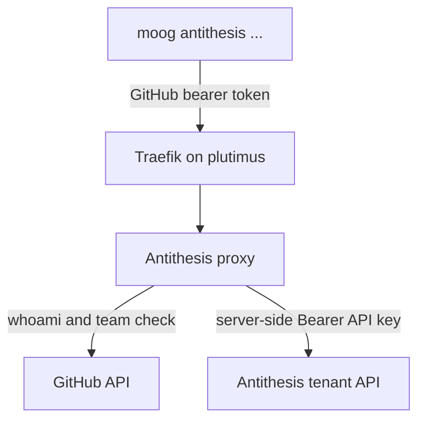
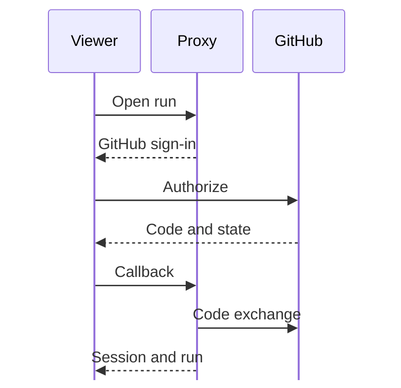
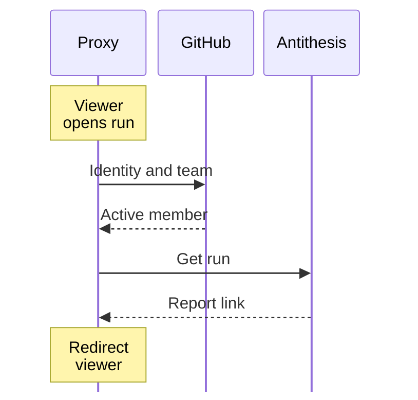

# Antithesis Proxy

As an authorized GitHub team member, use the Antithesis proxy to open
reports in your browser or read the tenant API with a bearer credential.
The proxy keeps the Antithesis API key on the server.
The executable is `moog-antithesis-proxy`.



## Endpoints

All endpoints below sit behind the `pragma-org/antithesis-access` GitHub
team check. Public probe routes (`/healthz`, `/readyz`) require no
auth; API routes return `401` for missing/invalid bearer tokens
and `403` for tokens whose owner is not an active team member.

| Path | Upstream shape | Notes |
|---|---|---|
| `GET /healthz` | `200 ok` | no auth |
| `GET /readyz` | `200 ready` / `503 not ready` | no auth; probes Antithesis + GitHub reachability |
| `GET /api/v0/openapi.json` | JSON | live OpenAPI spec from the Antithesis tenant — the authoritative schema for every other endpoint |
| `GET /api/v0/runs` | JSON | supports `?limit=` (max 100 upstream) and `?cursor=`; the response body carries `next_cursor` for follow-up calls |
| `GET /api/v0/runs/{run_id}` | JSON | single run detail; includes `failure_moment` for `incomplete` runs |
| `GET /api/v0/runs/{run_id}/properties` | JSON | pass/fail per property; **404 for `in_progress` runs** (Antithesis-side rule) |
| `GET /api/v0/runs/{run_id}/events?q=` | NDJSON | free-text substring search; upstream caps at 50 results |
| `GET /api/v0/runs/{run_id}/logs?input_hash=&vtime=` | NDJSON | logs at a specific moment |
| `GET /api/v0/runs/{run_id}/build_logs` | NDJSON | full build log stream |

The NDJSON endpoints stream upstream bytes through the proxy verbatim
(via Servant `StreamGet NoFraming PlainStream (SourceIO ByteString)`);
the proxy holds the upstream connection open through the WAI response
emission. Unknown API paths return `404` after authorization.
The separate [browser routes](#open-a-report-in-your-browser) use server
sessions and fresh team checks.

## CLI

The `moog antithesis` subcommand group on the moog binary derives its
client from the same Servant API the server serves, so the surfaces
stay in sync.

```text
moog antithesis runs   [--limit N] [--cursor S]
moog antithesis run    --run-id RUN_ID
moog antithesis properties  --run-id RUN_ID
moog antithesis events     --run-id RUN_ID [--q QUERY]
moog antithesis logs       --run-id RUN_ID [--input-hash HASH] [--vtime VTIME]
moog antithesis build-logs --run-id RUN_ID
```

JSON commands emit canonical JSON on `stdout`. NDJSON commands stream
upstream bytes verbatim to `stdout` (so each line is one JSON record)
inside a `Servant.Client.Streaming.withClientM` callback that keeps the
upstream connection alive for the full drain.

Exit codes:

- `0` success
- `2` authorization or SSO failure (`401`/`403` from the proxy)
- `3` proxy or network failure (`5xx` or transport error)
- `4` proxy returned a non-JSON body where JSON was expected

### Pagination

```bash
moog antithesis runs --limit 100 \
  | jq -r '.next_cursor // empty' \
  | xargs -r -I{} moog antithesis runs --limit 100 --cursor {}
```

The cursor is opaque; clients echo it back verbatim. Loop until
`next_cursor` is absent.

### First-time use

The first invocation triggers GitHub device-flow login against the
`lambdasistemi`-owned `moog` OAuth App; the resulting OAuth token is
cached at `~/.config/moog/github-oauth.json` (mode `0600`). Subsequent
calls reuse it. If a `pragma-org` admin hasn't approved the `moog` App
yet, the proxy returns `502 github membership check failed`; visit
<https://github.com/settings/connections/applications/Ov23liVVFVtdBez1QDxq>
and click "Request approval" for the `pragma-org` entry under
"Organization access" — once a `pragma-org` admin approves it, every
team member can use the proxy.

## Repository Artifacts

- Image: `ghcr.io/cardano-foundation/moog/moog-antithesis-proxy:<tag>`.
- Compose example: `docs/antithesis-proxy.compose.example.yaml`.
- Runtime port: `8080`.
- Public route: `https://antithesis-proxy.plutimus.com`.

Pin `MOOG_VERSION` to a concrete commit or release tag. Do not deploy
`latest`.

## Upstream API model

The proxy forwards to `amaru-cardano.antithesis.com/api/v0/...` by
default, attaching the server-held Antithesis API key as
`Authorization: Bearer <key>`. The API key is **different** from the
`pragma:<password>` basic-auth pair `moog-agent` uses to call
`POST /api/v1/launch/<launcher>`; the launch pair is not valid for the
read API.

Obtain the API key from Antithesis support or from your forward-deployed
engineer.

## Plutimus Layout

Copy the compose example to:

```text
/opt/hal/infrastructure/moog/antithesis-proxy/docker-compose.yaml
```

Create the secrets layout:

```text
/secrets/moog-antithesis-proxy/
  new/
    antithesis-api-key
  old/
    antithesis-api-key
```

`antithesis-api-key` is the plain-text value read by
`MOOG_ANTITHESIS_API_KEY_FILE` (default
`/run/secrets/antithesis-api-key`).

## Deploy

```bash
cd /opt/hal/infrastructure/moog/antithesis-proxy
MOOG_VERSION=<pinned-tag> docker compose pull moog-antithesis-proxy
MOOG_VERSION=<pinned-tag> docker compose up -d moog-antithesis-proxy
```

Restart the service after config or secret changes:

```bash
MOOG_VERSION=<pinned-tag> docker compose up -d --force-recreate moog-antithesis-proxy
```

Stop it with:

```bash
docker compose down
```

Read logs with:

```bash
docker logs antithesis-proxy-moog-antithesis-proxy-1
```

Each bearer API or public probe request emits one structured JSON line.
Browser routes omit request logging to protect sign-in and report secrets:

```json
{"login":"paolino","path":"/api/v0/runs","status":200,"upstream_status":200,"latency_ms":1641,"request_id":"-","ts":"…"}
```

## Acceptance Checks

```bash
curl -i https://antithesis-proxy.plutimus.com/healthz
curl -i https://antithesis-proxy.plutimus.com/api/v0/runs
curl -i -H 'Authorization: Bearer garbage' \
  https://antithesis-proxy.plutimus.com/api/v0/runs
TOK=$(jq -r .access_token ~/.config/moog/github-oauth.json)
curl -i -H "Authorization: Bearer $TOK" \
  https://antithesis-proxy.plutimus.com/api/v0/runs?limit=1
```

Expected results:

- `/healthz` returns `200` with body `ok`.
- `/api/v0/runs` without auth returns `401` and
  `WWW-Authenticate: Bearer realm="moog-antithesis-proxy"`.
- `/api/v0/runs` with garbage auth returns `401`.
- `/api/v0/runs` with a valid `pragma-org/antithesis-access` member
  token returns `200` and the Antithesis runs JSON body.

Detail and streaming endpoints can be probed by substituting the
`run_id` returned in the first response.

## Secret rotation

Rotate the Antithesis API key by mirroring the `moog-agent` rotation
pattern: write the new value to
`/secrets/moog-antithesis-proxy/new/antithesis-api-key`, move the
previous file to `old/`, then force-recreate the container.

```bash
read -rs KEY
printf '%s' "$KEY" \
  | sudo tee /secrets/moog-antithesis-proxy/new/antithesis-api-key >/dev/null
unset KEY
sudo chmod 0400 /secrets/moog-antithesis-proxy/new/antithesis-api-key
cd /opt/hal/infrastructure/moog/antithesis-proxy
MOOG_VERSION=<pinned-tag> sudo -E docker compose up -d --force-recreate moog-antithesis-proxy
```

## Architecture

The proxy and its CLI clients are all derived from a single
`AntithesisProxyAPI` type defined in `Proxy.Antithesis.Api`. That type
is the concatenation of two sub-APIs:

- `AntithesisProxyJsonAPI` — the three JSON endpoints, exposed with
  `Get '[PlainJSON] Value`. Both the proxy server and the CLI talk to
  the upstream via the regular non-streaming
  `Servant.Client.ClientM`. The proxy server hoists the auto-derived
  upstream client into the Servant `Handler` monad — every JSON
  handler is a one-line `runUpstream env (clientFn args…)`.

- `AntithesisProxyStreamAPI` — the three NDJSON endpoints, exposed
  with `StreamGet NoFraming PlainStream (SourceIO ByteString)`. The
  CLI uses `Servant.Client.Streaming.withClientM` to drain the
  `SourceIO` to stdout. The proxy server uses `http-client` directly
  to open an upstream streaming response and wrap its body reader as
  a `SourceIO ByteString`, so the upstream TCP connection stays alive
  while Servant's WAI server emits frames downstream.

The split exists because `servant-client` and
`servant-client-streaming` ship two distinct `ClientM` monads; an API
combining `Get` and `StreamGet` cannot be derived under a single one.
Splitting at the API-type level lets the JSON and streaming halves
each pick their natural transport while still sharing all path
fragments and Capture / QueryParam types.

## Upstream documentation

The Antithesis tenant is the source of truth for the data shapes. The
proxy passes payloads through verbatim, so the upstream schema is also
the proxy's schema.

- **Live OpenAPI spec** — `GET /api/v0/openapi.json` on the proxy
  returns the tenant's own OpenAPI document. Team members can fetch
  it without holding the API key:

  ```bash
  TOK=$(jq -r .access_token ~/.config/moog/github-oauth.json)
  curl -sS -H "Authorization: Bearer $TOK" \
    https://antithesis-proxy.plutimus.com/api/v0/openapi.json \
    | jq '.paths | keys'
  ```

  Equivalently, operators with the Antithesis API key can dump the
  spec directly with `anti openapi` from the `antithesis-api` skill.

- **`antithesis-api` skill** — sibling skill in this repo's operator
  toolkit. It carries the human-friendly recipes (`anti runs`,
  `anti properties`, `anti events`, `anti logs`, `anti report-url`)
  and the per-endpoint response-shape notes that don't fit in an
  OpenAPI doc (e.g. the embedded-JSON `description` field on a run,
  the `failure_moment` semantics for incomplete runs, the
  free-text-only nature of `events?q=`, and the 50-result cap).

- **Triage report URL** — every run object's `links.triage_report`
  field is a ready-to-open browser URL on the tenant
  (`https://amaru-cardano.antithesis.com/report/…`). The
  authorisation token is baked into the URL itself; no separate
  Antithesis SSO login is required to view it.

## Live Deployment Status

The proxy is deployed and healthy on plutimus. Operators can verify
the public health endpoint at
<https://antithesis-proxy.plutimus.com/healthz>. The full end-to-end
smoke (device-flow login from a clean container + `moog antithesis
runs`) is covered by the `antithesis-api` skill's `anti runs` flow
once a member of `pragma-org/antithesis-access` has authorized the
`moog` OAuth App.

## Open a report in your browser

As an active member of the GitHub team `pragma-org/antithesis-access`,
open a run's report link from the dashboard. The Antithesis proxy asks
GitHub to sign you in, then opens the selected report. Access is shared
across the team, including reports requested by automation or another
person. You need a GitHub account with active team membership.

The dashboard links to
`https://antithesis-proxy.plutimus.com/browser/report/<run-id>`.
It publishes the run ID, while the signed report URL stays private until
the proxy authorizes its disclosure. The browser navigates to the proxy
as a top-level page; cookies belong to the proxy origin.

Sign-in binds the callback to the initiating browser and resumes only
its selected run. The code exchange and its verifier remain on the server.



For every report opening, the proxy checks current membership before
asking Antithesis for a link. It validates the destination before redirecting.



The proxy checks identity and current membership before each report
lookup. Pending invitations and non-members receive `403`. An expired
session starts sign-in again. A revoked GitHub credential receives
`401`; sign out and open the report again. GitHub verification failures
and provider failures receive `502` with a safe message. Starting or
running tests receive `409`; runs with no report receive `404`.
Cancelled or invalid callbacks receive `400` and grant no session.

Visit `/browser/account` on the proxy to sign out through its form.
Sign-out requires a same-origin POST and a session-specific form token.
Session expiry, sign-out and membership removal prevent future report
retrieval through the proxy. **They do not revoke a signed URL already
disclosed.** Anyone possessing that URL can reuse or share it, subject
to the tenant's own report access policy. See
[Antithesis report access](https://antithesis.com/docs/configuration/auth/#report-access).

| Design choice | Reason |
|---|---|
| Top-level navigation to the proxy | Works without cross-origin credentialed fetch or third-party cookies |
| Server-side opaque sessions | OAuth credentials stay on the server; browser JavaScript does not decide authorization |
| Fresh GitHub identity and team checks | A previous grant cannot hide removed membership; the CLI retains its separate membership cache |
| HTTPS destination on the configured tenant under `/report/` | Provider output cannot redirect the viewer to an arbitrary host or API path |

Browser routes return `Cache-Control: no-store`, `Referrer-Policy:
no-referrer` and a restrictive content security policy. Session and
login-binding cookies are host-only, Secure and HttpOnly, with
`SameSite=Lax`. Only the browser routes accept these cookies; CLI API
routes still require GitHub bearer tokens. Browser routes deliberately
emit no request audit lines, so callbacks, session values and report
capabilities cannot enter the daemon's request log.

## Install browser sign-in

As the proxy operator, configure an OAuth application with its callback
on the proxy's HTTPS origin and a mounted client secret. Keep the client
secret and Antithesis API key server-side. Organization approval for the
application and a token with `read:org` access are needed to verify team
membership. GitHub's
[web authorization flow](https://docs.github.com/en/apps/oauth-apps/building-oauth-apps/authorizing-oauth-apps)
documents authorization-code exchange and PKCE using SHA-256.

| Environment variable | Value |
|---|---|
| `MOOG_PROXY_BROWSER_CLIENT_ID` | Browser OAuth application client ID; explicitly supplied |
| `MOOG_PROXY_BROWSER_CLIENT_SECRET_FILE` | Mounted secret file, for example `/run/secrets/github-browser-client-secret` |
| `MOOG_PROXY_BROWSER_CALLBACK_URL` | Exact HTTPS URL ending in `/browser/callback`, for example `https://antithesis-proxy.plutimus.com/browser/callback` |
| `MOOG_PROXY_BROWSER_SESSION_TTL_SEC` | Positive lifetime, default `3600`, maximum `86400` |
| `MOOG_PROXY_BROWSER_STATE_TTL_SEC` | Positive single-use state lifetime, default `300`, maximum `86400` |

Missing, partial, invalid or unreadable browser settings disable the
browser routes with `503`; the bearer API remains available. Callback
URLs accept a plain HTTPS hostname and the fixed callback path. The
configured `MOOG_ANTITHESIS_URL` must be a plain HTTPS tenant origin for
report redirects; custom ports and provider API paths are refused.

Each process holds at most 10,000 pending sign-ins and 10,000 sessions.
Expired entries are removed on browser requests. At capacity new
sign-ins receive `503`. A restart discards all sessions and login state.
Deploy one proxy instance; multiple instances require a shared session
store or routing affinity, which this implementation does not provide.

Extend the existing restricted secret mount with
`github-browser-client-secret`, then set the explicit browser variables
from the Compose example. Confirm the registered callback and organization
approval before enabling the browser configuration. Inspect the reverse
proxy's access logging: it must omit callback query strings, cookies,
OAuth codes/tokens, response Location headers and report URLs. Do not
send these values to telemetry or paste them into issues.

### Verification and rollback

Run the compiled local HTTP suite and the proxy image build:

```bash
nix run .#unit-tests -- --match Proxy.Antithesis
nix build .#moog-antithesis-proxy-docker-image
MOOG_VERSION=<pinned-tag> docker compose -f docs/antithesis-proxy.compose.example.yaml config --quiet
```

The HTTP suite runs the production router and real loopback upstreams.
It verifies callback binding/replay, PKCE using SHA-256, session expiry/rotation,
protected sign-out, membership denial/removal/failure, destination
refusal and cookie/bearer separation. It does not establish genuine
GitHub sign-in or production tenant acceptance.

After deploying the pinned image and configuration, open a known report
in a browser with an active member, then with a non-member. Check
cancellation, expiry and sign-out. Verify a subsequent lookup after team
membership removal is refused. Record only outcomes and public run IDs;
keep signed report URLs and credentials out of receipts. Verify the CLI
still works with its existing bearer credential. Installation is complete
only after these actual account and deployment checks succeed.

To disable browser access, remove its three required settings and
recreate the service. To roll back the release, restore the saved image
pin and Compose settings and recreate it. Either action clears browser
sessions. Previously disclosed Antithesis report URLs remain usable.
